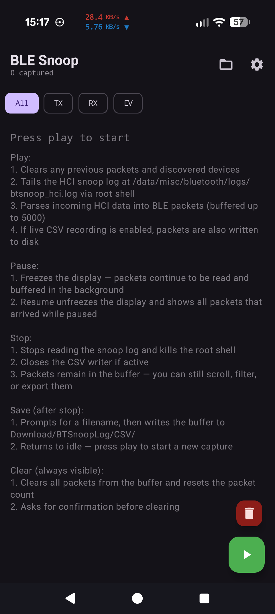
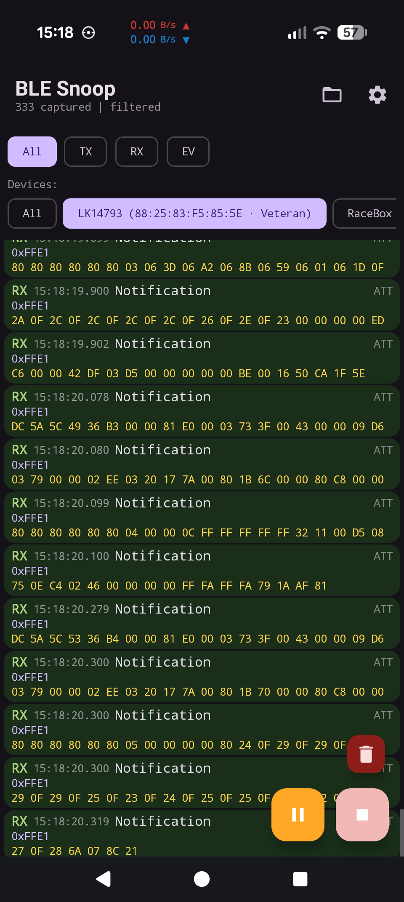
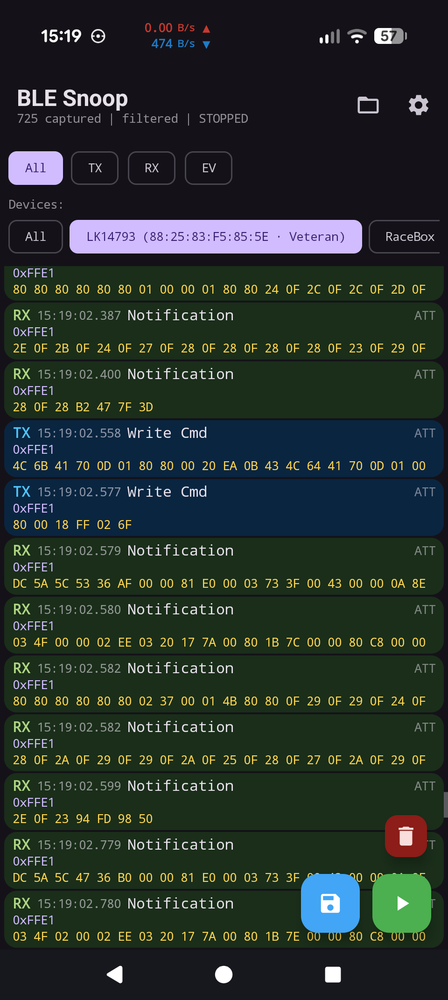
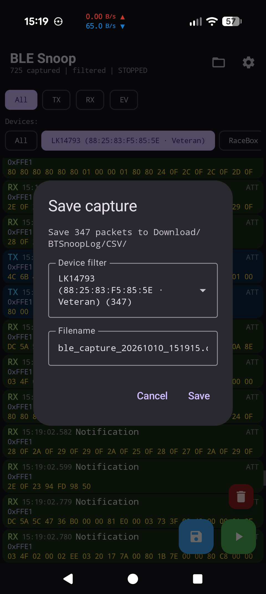
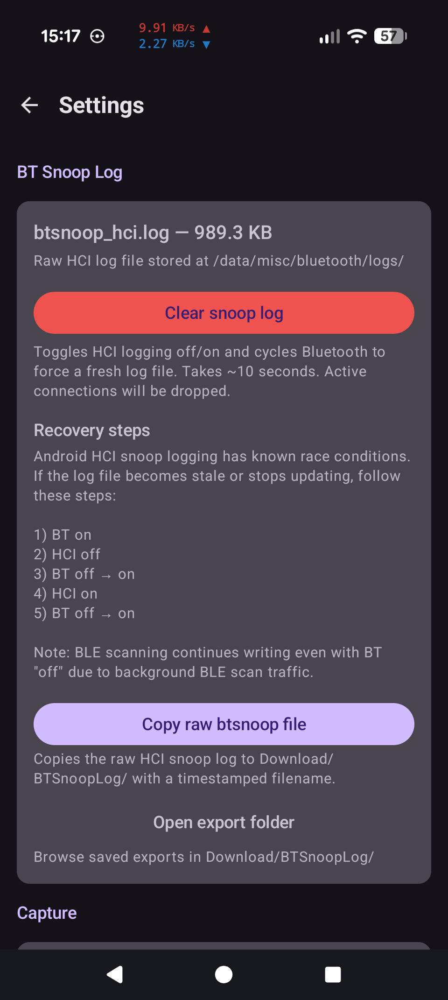
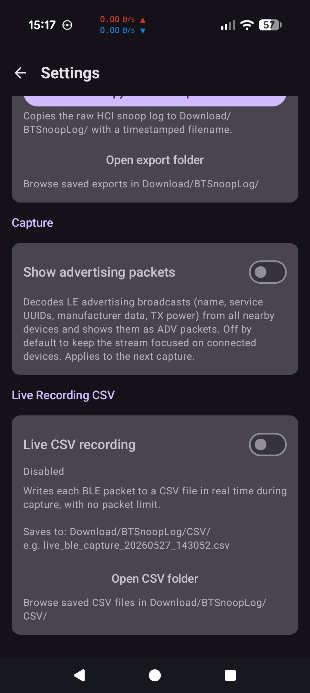

# BLE Snoop

A live Bluetooth HCI packet viewer for **rooted** Android devices. It tails the
system `btsnoop_hci.log` file as the Bluetooth stack writes it, decodes each
record on the fly, and shows a scrolling list of BLE traffic with per-device
filtering and CSV export.

Useful for reverse-engineering BLE peripherals and their companion apps without
pulling logs off the phone and opening them in Wireshark every time.

## Screenshots

<table>
  <tr>
    <td></td>
    <td></td>
    <td></td>
  </tr>
  <tr>
    <td align="center">Idle</td>
    <td align="center">Live capture, filtered to one device</td>
    <td align="center">Stopped, ready to save</td>
  </tr>
  <tr>
    <td></td>
    <td></td>
    <td></td>
  </tr>
  <tr>
    <td align="center">Save to CSV</td>
    <td align="center">Settings: snoop log</td>
    <td align="center">Settings: capture and live CSV</td>
  </tr>
</table>

## Requirements

- Android 12 or newer (API 31+).
- Root access via Magisk, KernelSU, or similar. The app runs `su` to read
  `/data/misc/bluetooth/logs/btsnoop_hci.log`.
- **Bluetooth HCI snoop log** enabled in Developer Options. The app cannot
  turn this on for you.

Without root the app will not work. There is no non-root mode.

## Features

- Live capture using a single long-running `tail -f` through a persistent root
  shell, so Magisk prompts once per session instead of on every read.
- Decodes the btsnoop container, HCI command/event/ACL packets, L2CAP, ATT
  (reads, writes, notifications with opcode names), and RFCOMM.
- Decodes LE advertising reports into ADV packets with flags, device name,
  service UUIDs, manufacturer data, TX power, and appearance.
- Resolves connection handles to peer MAC addresses by pre-scanning the
  existing log for connection-complete events before tailing.
- Watches GATT discovery responses and labels later reads, writes, and
  notifications with the characteristic name instead of a bare handle.
- Pluggable protocol identification registry for labelling device-specific
  traffic. Ships with an identifier for electric unicycle (EUC) protocols.
  Add your own by implementing `ProtocolIdentifier` and registering it.
- Filter by direction (TX / RX / event) and by discovered device, with
  advertised or remote device names shown in the picker.
- Hex and printable-ASCII view of each payload.
- **Live CSV recording** with no packet limit and a REC banner on the main
  screen, or save the in-memory buffer to CSV after stopping a capture
  (prompts for a filename, optionally filtered to one device).
- Copy the raw `btsnoop_hci.log` out to shared storage for Wireshark.
- One-tap "clear snoop log" that cycles HCI logging and Bluetooth to force a
  fresh file.

## Output

CSV files land in `Download/BTSnoopLog/CSV/` on shared storage. Raw log copies
go in `Download/BTSnoopLog/`. Columns:

```
timestamp,direction,device_address,packet_type,opcode,handle,data_hex,data_ascii
```

## Building

The project uses Gradle 9.3 and Android Gradle Plugin 9.0, which need Android
Studio Otter 3 (2025.2.3) or newer. It compiles with a JDK 25 toolchain and
targets API 37 (Android 17), minimum API 31. If no JDK 25 is installed, Gradle
downloads one automatically via the foojay toolchain resolver.

```bash
./gradlew assembleDebug
adb install app/build/outputs/apk/debug/app-debug.apk
```

The debug build installs as `com.jc84.blesnooplogger.debug` with the label
"(D) BLE Snoop", so it can sit alongside a release build.

Debug builds are signed with your machine's own `~/.android/debug.keystore`,
as with any Android project. No keystore is checked in, so a debug build from
a second machine will not install over one from the first
(`INSTALL_FAILED_UPDATE_INCOMPATIBLE`); uninstall the old build first.

There is no release signing config in the repo. To build a signed release,
add a `keystore.properties` file (already gitignored) and wire it into
`app/build.gradle` yourself.

## Pulling logs off the phone

`.claude/skills/btsnoop_ADB/sync_logs.sh` pulls new capture files from
`Download/BTSnoopLog/` over ADB into a local `BTSnoopLogs/` folder (gitignored)
and archives them to `processed/` on the phone.

## Known issues

Android's HCI snoop logging has race conditions, and the log file sometimes
goes stale or stops growing. If capture shows nothing, the Settings screen
has a recovery sequence: toggle Bluetooth on, HCI logging off, Bluetooth
off/on, HCI logging on, Bluetooth off/on. The "Clear snoop log" button does
this for you but drops active connections.

## Privacy

HCI captures contain everything the Bluetooth stack saw: peer MAC addresses,
device names, pairing exchanges, and raw application data. Review CSV and raw
log files before sharing them.

## License

MIT. See [LICENSE](LICENSE).
